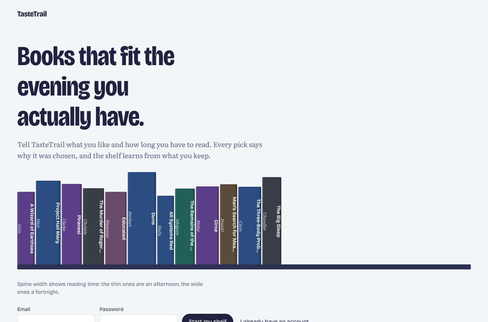
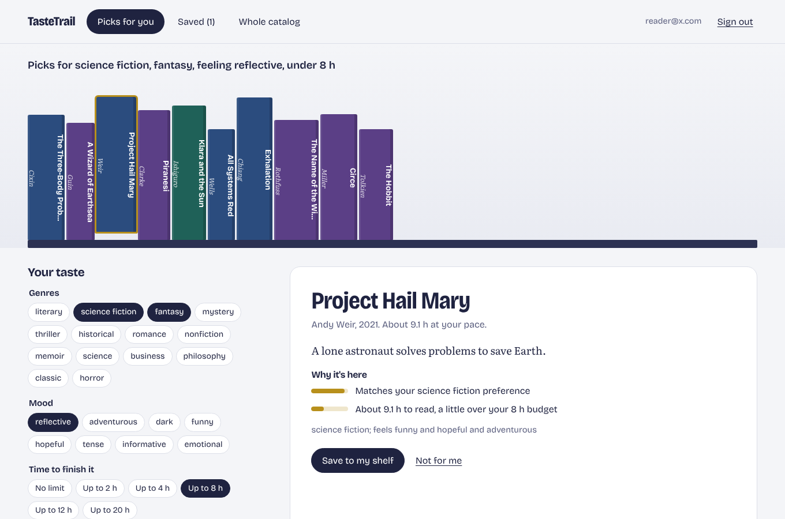
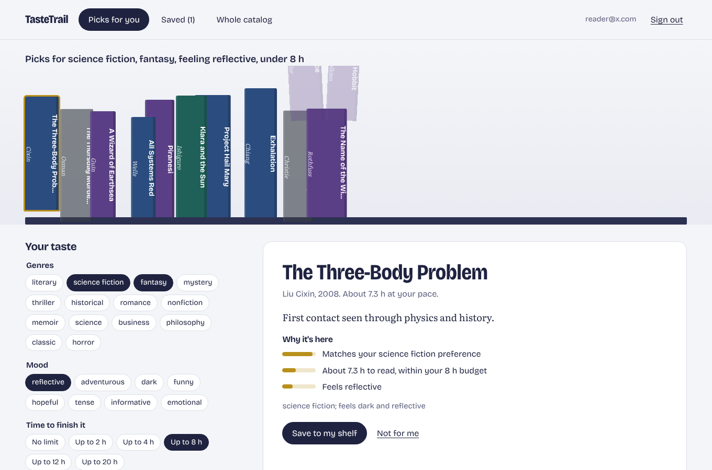

# TasteTrail

Personalized book discovery with an explainable, deterministic ranking engine. Pick genres, a mood
and how much reading time you actually have; TasteTrail ranks a 42-book catalog server-side, tells
you *why* each book was chosen, and learns from what you save or dismiss.




## Interface

Recommendations are shown as a bookshelf. Each spine's width is the book's reading time at your pace, its
colour is its main genre, and the best match stands first. Changing a genre, mood or time budget re-ranks the
shelf in place: books that no longer fit drop away, new ones slot in, and the rest slide to their new rank
(FLIP layout animation with Motion for React), which makes the effect of each preference visible. Selecting a
spine shows the reasons behind the pick, each with a bar sized by its contribution to the score. Type is
Bricolage Grotesque with Literata for prose (both SIL OFL). Reduced-motion preferences are respected.



## Ranking engine (`server/src/ranking`)

Each eligible book is scored on independent components, then re-ranked for variety:

| Component | Weight | How it's computed |
| --- | --- | --- |
| Genre match | 0.45 | IDF-weighted share of the book's genres the user selected (rare genres count more) |
| Reading-time fit | 0.20 | `pages × 275 / wpm` vs. budget; full score within budget, Gaussian decay above it, hard cut at 2× |
| Mood match | 0.15 | Fraction of selected moods the book carries |
| Shelf similarity | 0.15 | Max cosine similarity (TF-IDF over genres, moods, author) to books the user saved |
| Popularity prior | 0.05 | Weak tie-breaker |

- **Adaptive weighting:** components the user didn't express a preference for are dropped and the rest
  renormalised, so leaving the time budget empty doesn't penalise anything.
- **Diversity:** greedy Maximal Marginal Relevance, `λ·relevance − (1−λ)·max similarity to already-picked`,
  exposed in the UI as a "variety" slider.
- **Explanations** are generated from each component's actual contribution and sorted by it
  ("Matches your fantasy preference", "About 3.4 h to read, within your 8 h budget",
  "Similar to *Mistborn* on your shelf").
- **Deterministic:** pure function of its input; scores are rounded before comparison and ties break
  on book id, so results are identical regardless of catalog order (tested).

## Architecture

```
client/   React 19 + TypeScript + Vite + Motion
server/   Node.js + TypeScript + Express 5
  ├── app.ts          routes, Zod request validation, error mapping
  ├── auth.ts         bcrypt hashing, JWT (jose) bearer middleware
  ├── repository.ts   data access via Drizzle ORM; every user query keyed by userId
  ├── db/             SQLite (better-sqlite3), versioned transactional migrations, catalog upsert seeding
  └── ranking/        feature vectors + recommender (no I/O; unit-tested in isolation)
```

**Data model:** `users`, `books`, `preferences` (one row per user, upserted), `shelf_items` and
`dismissals` with composite primary keys `(user_id, book_id)`, which make "save" idempotent at the
database level (`INSERT … ON CONFLICT DO NOTHING`). Saving a book clears an earlier dismissal.

### API

| Method | Path | Notes |
| --- | --- | --- |
| POST | `/api/auth/register`, `/api/auth/login` | returns JWT |
| GET | `/api/me` | profile + saved preferences |
| GET / PUT | `/api/preferences` | validated genres, moods, budget, reading speed |
| POST | `/api/recommendations` | per-request overrides fall back to saved preferences |
| GET / POST / DELETE | `/api/shelf`, `/api/shelf/:bookId` | 201 on first save, 200 on repeat |
| POST / DELETE | `/api/dismissals`, `/api/dismissals/:bookId` | "not for me" feedback |
| GET | `/api/books`, `/api/meta` | public catalog with search / genre / time filters |

## Run locally

```bash
cd server && npm install && npm run dev      # http://localhost:3001
cd client && npm install && npm run dev      # http://localhost:5173 (proxies /api)
```

Environment: `TASTETRAIL_JWT_SECRET` (required in production), `TASTETRAIL_DB` (SQLite file path),
`PORT`.

## Tests

```bash
cd server && npm test
```

14 Vitest tests: determinism across catalog orderings, genre filtering, saved/dismissed exclusion,
shelf-based personalisation, budget handling, MMR diversity, explanation ordering, reading-time maths,
and Supertest API tests for auth, field-level validation errors, preference persistence, idempotent
shelf writes and per-user isolation. CI also type-checks the server and builds the client.
