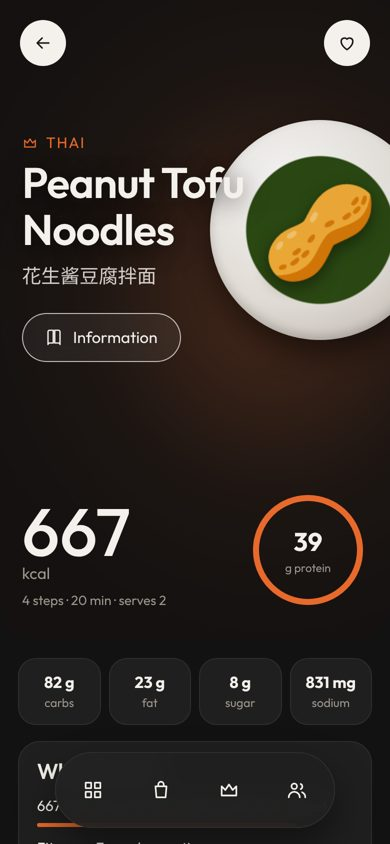
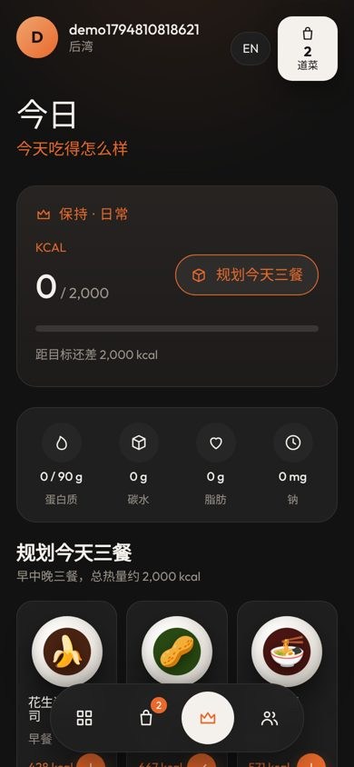
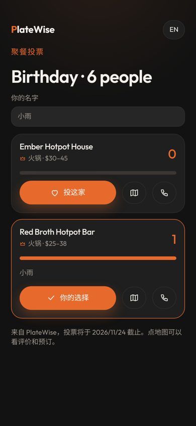
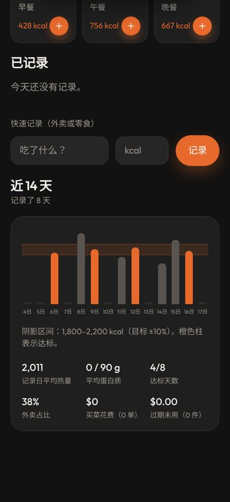
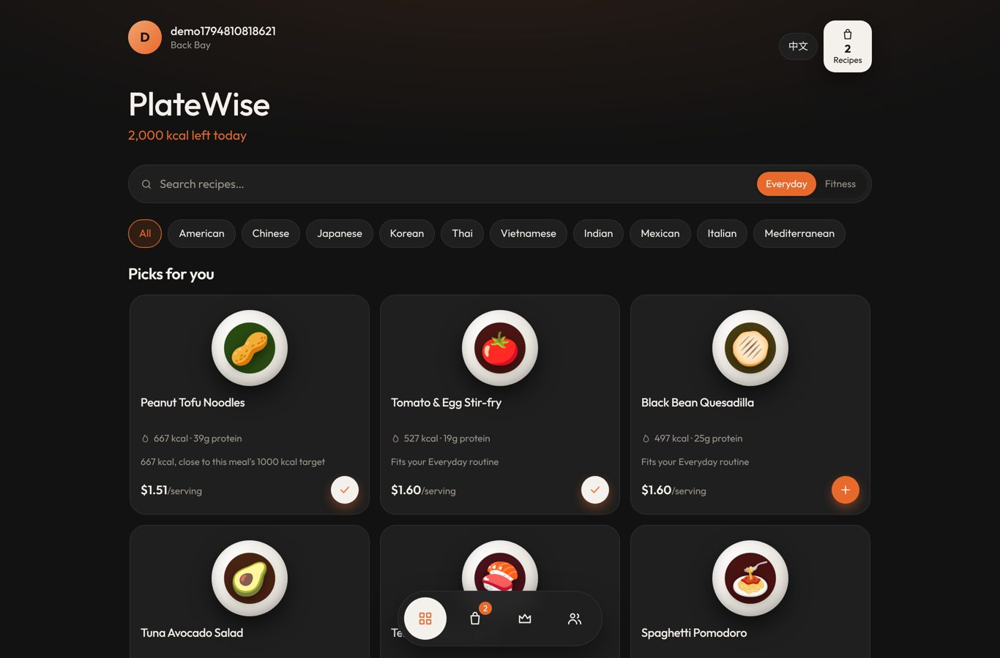

# PlateWise

Personalized meal recommendations for the U.S. market. PlateWise ranks recipes against your taste, calorie and protein targets, cooking time, budget and what is already in your kitchen. It explains every pick, turns a bag of recipes into a grocery list for Instacart or Kroger, and recommends a restaurant a whole group can agree on. The UI switches between English and Chinese and is built mobile-first.

The project plan, including the literature behind every scoring factor, is in [docs/PLAN.md](docs/PLAN.md) (Chinese).

| Sign up | Picks | Recipe | Bag | Today (中文) |
| --- | --- | --- | --- | --- |
|  |  |  |  |  |

| Group vote (shared link) | Trends |
| --- | --- |
|  |  |



## What it does

- **Two modes, one ranking engine.** *Everyday* (students and office workers: fast, cheap, uses what you have, optional low-sugar / low-sodium flags) and *Fitness* (cut or bulk: per-meal kcal and protein targets).
- **Dietary restrictions as hard filters, in three classes.** Vegetarian type (flexitarian, pescatarian, lacto-ovo, lacto, ovo, vegan), the FDA's 9 major allergens, and religious rules (halal, kosher including the meat-and-dairy combination check, Hindu, Jain, Buddhist, Lent Fridays computed from the Easter date). Recipes that need certified meat get a note instead of a false promise.
- **Six scoring factors with explanations.** Taste .25, nutrition .20, convenience (time + pantry) .15, collaborative filtering .15, familiarity .15, price .10. Weights renormalize when a factor has no signal (for example, CF for a brand-new user). Each pick carries reason codes the client renders in either language, and MMR re-ranking keeps the list varied.
- **Item-item collaborative filtering in SQL.** Cosine similarity over co-likes from imported ratings (≥ 4 stars) plus other users' saves and "cooked" logs.
- **Virtual fridge.** Logging a cooked recipe consumes pantry stock. Items about to expire boost recipes that use them.
- **Grocery hand-off.** The bag merges ingredients across recipes, subtracts what you have, prices the rest, and opens an Instacart shopping list (live through the Instacart Developer Platform when `INSTACART_API_KEY` is set, otherwise a mock page) or a Kroger cart (mock).
- **"Did you buy it?"** Every hand-off (grocery, DoorDash / Uber Eats, Google Maps) is stored as an intent. When you come back, the app asks once. A *yes* writes an order, pantry stock or a restaurant visit, which feeds future rankings. This is how PlateWise learns without access to partner order history, which those platforms do not expose.
- **Day planner as an integer program.** Picks breakfast, lunch and dinner to maximize ranking score minus calorie and protein misses, within the daily budget (branch and bound, javascript-lp-solver). On 500 random candidate sets it misses the kcal target by 29 kcal on average against 97 for the greedy planner, and meets the protein target on 92% of days against 37%; p95 solve time 17 ms (`npx tsx bench/mealplan-compare.ts`). Greedy remains the fallback when the budget makes the program infeasible.
- **Trends.** The last 14 days of calories against a ±10% target band, average protein, share of meals from takeout, confirmed grocery spend, and food that expired in the pantry unused.
- **Group dining.** Party size, occasion, cuisine, per-person budget, time and max travel. Each participant has a starting area and restrictions. Hard filters (open at that hour, travel limit, everyone's diet), then six factors: taste .25 (average without misery), travel fairness .20 (the longest trip, not the average), price .15, occasion fit .15, reputation .15 (Bayesian-smoothed rating), history .10. Each result opens Google Maps and shows the phone number; PlateWise does not book tables. **Start a vote** sends friends a link to the top picks; they vote by name without an account, and the vote closes after 7 days. With `GOOGLE_PLACES_API_KEY` set, candidates come live from Places API (New) Text Search around the group's midpoint; only place IDs are stored, per Google's terms.

## Stack

```
client/   React 19 + Vite + TypeScript, i18n context (en/zh), Outfit Variable, no UI kit
server/   Node 22 + Express 5 + TypeScript, Zod validation, JWT (jose) + bcrypt
          PostgreSQL via node-postgres; embedded PGlite (WASM Postgres) for dev and tests
          raw parameterized SQL, materialized view recipe_nutrition, GIN + pg_trgm indexes
          ranking/ (pure functions: engine, mealplan, group, restrictions)
          providers/ (Instacart, Kroger, Google Places, deep links)
          etl/ (Food.com and RecipeNLG importers, ingredient lexicon), eval/ (offline metrics)
          bench/ (synthetic Food.com-scale data, load test, query profiling)
```

## Run it

```bash
cd server && npm install && npm run dev     # API on :3001, data in ./pgdata (PGlite)
cd client && npm install && npm run dev     # UI on :5173, proxies /api to :3001
```

Tests: `cd server && npm test` (50 unit, ETL and API tests, each on a fresh in-memory PGlite).

| Variable | Default | Purpose |
| --- | --- | --- |
| `DATABASE_URL` | unset | Use a real PostgreSQL instead of embedded PGlite |
| `PLATEWISE_DATA_DIR` | `./pgdata` | PGlite data directory |
| `PLATEWISE_JWT_SECRET` | dev value | Required in production |
| `PLATEWISE_JWT_TTL_SECONDS` | `7200` | Token lifetime |
| `INSTACART_API_KEY` | unset | Live Instacart shopping-list links |
| `GOOGLE_PLACES_API_KEY` | unset | Live restaurants for group dining (else the fictional demo set) |
| `PORT` | `3001` | API port |

### Deploy

In production one Node service serves both the API and the built client (`server/dist` + `client/dist`), so there is a single URL and no CORS setup.

1. Create a free Postgres database on [Neon](https://neon.tech) and copy its connection string (it ends in `?sslmode=require`).
2. On [Render](https://render.com): **New → Blueprint**, pick this repository. `render.yaml` defines the service, build and start commands, and a health check on `/api/health`. Paste the Neon string into `DATABASE_URL` when asked; the JWT secret is generated for you.
3. Tables, the materialized view and the seed catalog are created on first start.

Without `DATABASE_URL` the service falls back to embedded PGlite on the instance disk, which Render wipes on every deploy. Render's free tier also sleeps after 15 minutes idle, so the first request after that takes about a minute.

To run the production build locally: `cd client && npm run build`, then `cd server && npm run build && npm start`, and open http://localhost:3001.

### Importing Food.com

The seed catalog is 32 bilingual demo recipes over 67 foods. The real catalog comes from the [Food.com Recipes and Interactions](https://www.kaggle.com/datasets/shuyangli94/food-com-recipes-and-user-interactions) dataset (Majumder et al., EMNLP 2019; research and non-commercial use). Download `RAW_recipes.csv` and `RAW_interactions.csv` yourself; they are not committed.

```bash
cd server
npm run etl:foodcom -- --recipes RAW_recipes.csv --interactions RAW_interactions.csv [--limit 50000]
npm run eval -- --out ../docs/EVAL.md      # offline evaluation on the imported ratings
```

- **Recipes**: desserts, drinks, sauces and similar are skipped (`--all-courses` keeps them), as are recipes with implausible times or nutrition and recipes using an ingredient seen fewer than 5 times.
- **Nutrition** comes from the dataset's own per-serving column. Its %DV values are converted to grams with the pre-2016 FDA daily values (`DAILY_VALUES` in `importFoodCom.ts`), so treat grams as approximate.
- **Restrictions**: ingredient names (Food.com has no quantities) go through a keyword lexicon (`etl/lexicon.ts`, with tests for common traps such as peanut butter, eggplant, coconut milk, rice noodles and red wine vinegar) that sets the allergen, meat, alcohol, allium and root flags.
- **Quantities** are category estimates, used only for the pantry, the shopping list and cost. The recipe page marks them as estimated.
- **Ratings**: ratings of 1–5 are kept with their dates (0 means a review without a rating).
- A full import is about 570 MB in PostgreSQL, above Neon's free 0.5 GB, so use `--limit` for a free deployment.
- Load testing and query tuning at this scale: [docs/PERFORMANCE.md](docs/PERFORMANCE.md).

An older RecipeNLG importer (`npm run etl:recipenlg`) parses quantities from free-text ingredient lines instead.

## Caveats

- Nutrient values and $/100 g prices in the seed data are approximate sample values, not USDA lookups. Load FoodData Central before trusting the numbers.
- Without a Places key, the 16 restaurants are fictional (555 phone numbers) around six Boston neighborhoods, so group dining works offline.
- Offline evaluation covers only the signals public ratings can test (popularity, CF, content familiarity). Taste, nutrition, convenience and price need real users' preferences and pantries.
- Deep-link formats for DoorDash (`/search/store/<q>/`) and Uber Eats (`/search?q=`) are not documented APIs and should be re-checked.
- Kroger checkout is a mock until OAuth credentials are added.
- Restriction filters depend on ingredient tagging. The UI tells users to check labels and tell the restaurant about allergies. Not medical advice.

## History

PlateWise started as TasteTrail, a book recommender. The explainable multi-factor ranking, MMR re-ranking and feedback loop carried over; the domain, data layer (SQLite → PostgreSQL), restrictions, hand-offs, group dining and UI are new.
