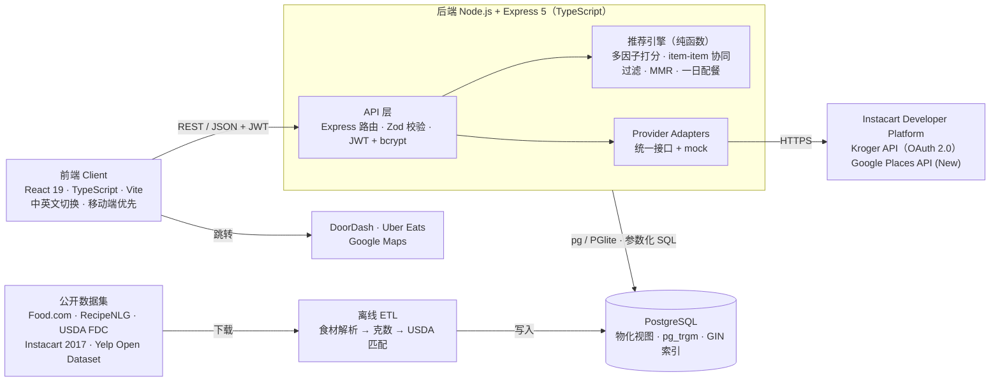

# 个性化饮食推荐平台 项目计划书（PlateWise）

> 2026-11-16 · 本文件导出自项目计划书文档，代码实现见仓库根目录 README。

## 项目概述

本项目在 TasteTrail（个人 GitHub 仓库，书籍推荐）的基础上，改造成一个面向美国用户（学生和上班族的日常吃饭、减脂/增肌人群，以及多人聚餐场景）的英文个性化饮食推荐平台（暂定名 **PlateWise**）。它把三类信号合在一起做推荐：用户的饮食记录、外卖订单、超市购物记录。推荐结果可以一键跳转到 Instacart、Kroger 买食材，DoorDash、Uber Eats 点外卖，或 Google Maps 去餐厅。

核心价值：

- **吃什么**：根据口味、热量/营养目标、烹饪时间和预算推荐菜谱或外卖。
- **用现有食材做**：根据最近买过的 grocery 推断家里有什么，优先推荐能用上这些食材的菜谱，减少浪费。
- **一键买齐**：把菜谱缺少的食材生成购物清单，跳转到超市平台下单。
- **越用越准**：每一次记录、下单、收藏或"不感兴趣"都会更新用户画像。

与 TasteTrail 的关系：复用它的 Node.js + React 全栈骨架、JWT 登录、收藏/不感兴趣反馈、多因子打分与推荐理由，以及 MMR 多样性重排。主要新增饮食记录、第三方平台集成、大规模数据管线和营养约束下的膳食组合。

## 目标用户与使用场景

本应用只面向美国市场。主打三类场景：学生和上班族的日常吃饭、减脂/增肌、多人聚餐。学生和上班族合为一类：外卖的送达时间和营养数据都拿不到，两者实际可做的推荐都是"快、便宜、以自己做为主"。多人聚餐是任何用户都可以发起的场景。控糖/低盐只作为口味偏好标签，不提供疾病饮食方案，并声明不构成医疗建议。

| 场景 | 典型情况 | 关键约束 | 推荐重点 |
| --- | --- | --- | --- |
| 学生 / 上班族（日常吃饭） | 宿舍或公寓做饭、工作日午餐和下班后快速吃饭、偶尔点外卖、每周一次超市采购 | 预算有限、厨具简单、时间紧；可选控糖/低盐偏好 | 「快速 + 控糖/低盐」模式（见下表）：便宜、快手、用现有食材；留学生想吃家乡菜；外卖只按菜品类型给提示，不做营养数值判断 |
| 减脂 / 增肌 | 每天记录饮食、控制热量和蛋白质、周末备餐 | 热量、蛋白质、碳水等宏量营养素目标 | 营养达标的一日三餐组合 |
| 多人聚餐 | 朋友聚会、生日、团队聚餐、约会 | 人数、人均预算、每个人的路程、所有参与者的饮食限制 | 合并多人偏好后推荐餐厅，跳转 Google Maps（见「聚会餐厅推荐」） |

**日常吃饭「快速 + 控糖/低盐」指标（学生与上班族）**

快速是默认开启的主指标；控糖和低盐是用户可以单独打开的偏好。打开后，超过阈值的菜品降低排名并标注原因，但不完全隐藏。阈值参考[《美国膳食指南》2020–2025](https://www.dietaryguidelines.gov/top-10-things-you-need-know-about-dietary-guidelines-americans-2020-2025)和 [2025–2030 版](https://sandovalextension.nmsu.edu/documents/Dietary-Guidelines-for-Americans-2025-2030.pdf)，用户可以在设置里调整。

| 维度 | 指标 | 默认目标（每餐） | 数据来源 |
| --- | --- | --- | --- |
| 快速 | 总耗时（备料 + 烹饪） | ≤ 20 分钟 | 菜谱的 minutes / TotalTime 字段 |
| 快速 | 步骤数、食材数、是否需要额外采购 | ≤ 6 步、≤ 8 种食材、优先库存已有 | 菜谱解析 + 虚拟冰箱 |
| 控糖 | 添加糖 | ≤ 10 g（2025–2030 版指南的每餐建议） | 营养计算；菜谱数据较难区分添加糖，用总糖近似并在页面上注明 |
| 控糖 | 含糖饮料、甜品、精制主食 | 标注并降低排名；推荐无糖饮品、全谷物替代 | 食材分类 + 菜品标签 |
| 低盐 | 钠 | ≤ 约 770 mg（每日 < 2,300 mg 按三餐均分） | 营养计算 |
| 低盐 | 高盐食材和做法 | 腌制、加工肉、重酱料（酱油、鱼露、即食汤包）标注并降低排名 | 食材分类 |
| 价格 | 每餐花费 | 用户设定（如 ≤ $10） | Kroger 商品价格 |

**地域与文化个性化**：用户填写 ZIP code 后，系统按附近可用超市筛选能买到的食材，并结合当季食材加分。饮食文化偏好（如中餐南方/北方口味、墨西哥菜、南方美式）作为冷启动先验，用户有了真实行为数据后权重自动降低。

**饮食限制（三类分开设置）**

饮食限制在注册时分三类填写：素食类型、过敏原、宗教忌口。三类都是硬过滤，但判断方式和可靠程度不同，所以分开存储、分开展示提示。

| 类别 | 可选项 | 如何判断 | 局限与提示 |
| --- | --- | --- | --- |
| 素食类型 | 弹性素食、鱼素（吃海鲜不吃肉）、蛋奶素、蛋素、奶素、纯素（vegan） | 食材按来源分类（牲畜肉、禽肉、海鲜、蛋、奶、蜂蜜、明胶等），每种素食类型对应一组禁用类别 | 高汤、鱼露、猪油等"隐藏动物成分"要单独列入同义词表 |
| 过敏原 | 美国 FDA 规定的 9 种主要过敏原：牛奶、鸡蛋、鱼、甲壳类海鲜、树坚果、花生、小麦、大豆、芝麻；可自定义添加 | 过敏原同义词表（如 tahini → 芝麻，whey / casein → 牛奶）；外卖和餐厅无法准确判断，只提示 | 无法判断交叉污染；每条推荐都显示"请自行核对配料"，餐厅和外卖建议下单前告知店家 |
| 宗教忌口 | 清真（Halal）、犹太洁食（Kosher）、印度教（不吃牛肉）、耆那教、佛教素食、天主教四旬期周五不吃肉等 | 能从食材判断的部分做硬过滤：猪肉、牛肉、贝类、酒精、肉奶同餐、根茎类、葱蒜等；四旬期这类规则只在对应日期生效 | 屠宰方式和认证无法从菜谱判断：菜谱标注"食材符合，肉类需购买认证产品"；餐厅用 halal / kosher 标签筛选；各派别严格程度不同，允许用户微调具体禁用项 |
| 其他饮食选择 | 无麸质、无乳糖、低碳水/生酮、控糖、低盐 | 由用户选择作为硬过滤或仅作偏好加分 | 不作医疗用途 |

**各场景的筛选条件（Filter）**

每个场景的推荐页都有一排筛选器。硬筛选不满足就直接剔除；软偏好不剔除，只影响排序。默认值来自注册资料，用户可以在当次搜索中临时修改。

| 场景 | 硬筛选 | 软偏好（参与打分） |
| --- | --- | --- |
| 所有场景通用 | 三类饮食限制、点过"不感兴趣"的内容 | 口味、菜系、价格 |
| 学生 / 上班族 · 日常吃饭 | 单餐预算上限、可用厨具（只有微波炉 / 电磁炉 / 有烤箱）、总用时上限（默认 20 分钟） | 库存匹配、价格越低越好、家乡菜、控糖/低盐（开启时） |
| 减脂 / 增肌 | 单餐热量上下限、蛋白质下限 | 宏量营养素贴合度、食材多样性 |
| 多人聚餐 | 人数、营业时间、每个人的路程上限、人均预算、所有参与者饮食限制的并集 | 菜系与口味、距离公平、价格、主题与同伴、口碑、历史偏好 |

## 核心功能

P0 是第一版必须做完的功能，P1/P2 视时间追加。

| 优先级 | 功能 | 说明 |
| --- | --- | --- |
| P0 | 注册与偏好设置 | 口味、菜系、饮食限制（素食类型、过敏原、宗教忌口三类分开设置）、目标（减脂/增肌/维持）、ZIP code、每周预算 |
| P0 | 饮食记录 | 手动记录、从菜谱"我做了这道"一键记录、搜索 USDA 食物库；自动汇总每日热量和宏量营养素 |
| P0 | 菜谱推荐 | 多因子打分 + 推荐理由（沿用 TasteTrail 的解释式设计）；收藏 / 不感兴趣 / 打分 |
| P0 | 一键买齐食材 | 把菜谱食材减去"家里已有"，生成购物清单，跳转到 Instacart 或加入 Kroger 购物车 |
| P0 | 购物记录 → 库存推断 | 每次采购记入"虚拟冰箱"，按食材保质期自动衰减；推荐优先用快过期的食材 |
| P1 | 外卖订单记录 | 跳转外卖平台后由用户确认下单，或手动录入；提取菜品、菜系、价格，更新口味画像 |
| P1 | 外卖跳转 | 推荐"今天点什么"（菜品类型 + 营养建议），用深度链接打开外卖 App 的搜索页 |
| P1 | 一日 / 一周膳食计划 | 在热量、蛋白质和预算约束下组合三餐，合并成一张购物清单 |
| P2 | 营养趋势仪表盘 | 每周热量、蛋白质、外卖占比、食材浪费率 |
| P1 | 快速 + 控糖/低盐模式 | 学生和上班族日常吃饭时使用：按「快速 + 控糖/低盐」指标排序菜谱；外卖只按菜品类型给提示 |
| P1 | 聚会餐厅推荐 | 按人数、主题、菜系、人均预算、距离推荐餐厅，跳转 Google Maps 并显示电话（详见下一节） |
| P1 | 多人聚餐偏好合并 | 参与者的饮食限制取并集做硬过滤；口味按「平均但排除不满」合并（见推荐算法）；可发投票链接 |

**推荐信号如何从订单和购物记录来**：

1. 外卖订单 → 菜系和口味偏好（常点泰餐 → 提高泰式菜谱权重）；订单频率和价格 → 反推"不想做饭"的时段和预算。
2. 超市购物 → 家里现有食材（库存匹配度）；常买品牌和食材 → 长期偏好；买了却没做的食材 → 近期应优先推荐。
3. 饮食记录 → 当天还剩多少热量和蛋白质预算，决定下一餐推荐什么。

## 聚会餐厅推荐

用户输入人数、主题、口味、人均预算和距离，系统推荐 5 家餐厅并给出推荐理由。例如："8 个人、朋友生日、想吃火锅、人均 $30–40、每个人过去都不超过 20 分钟"。每家餐厅显示电话和一个"在 Google Maps 中打开"按钮，用户在 Google Maps 里看评价、导航或使用餐厅自己的预订入口，也可以直接打电话预约。本平台不接入任何预订系统。

**输入项**

| 输入 | 可选值举例 |
| --- | --- |
| 人数 | 2–20 人 |
| 主题 | 朋友聚餐、生日、约会、团队聚餐、商务宴请、家庭聚餐 |
| 菜系 / 口味 | 火锅、韩式烤肉、日料、意大利、墨西哥、印度、泰国、美式 BBQ；辣度；"都行"（由系统按大家的画像推荐） |
| 人均预算 | $15–25、$25–50、$50+ |
| 距离 | 以自己为中心的半径；或输入每个人的出发地，系统找对所有人都公平的位置 |
| 日期时间 | 用于筛选营业时间 |
| 饮食限制 | 素食类型、过敏原、宗教忌口（由各参与者通过分享链接自己填写） |

**打分因子**

| 因子 | 权重 | 计算方式 | 文献依据 |
| --- | --- | --- | --- |
| 菜系与口味匹配 | 0.25 | 餐厅类别与指定菜系；未指定时按「平均但排除不满」合并参与者画像 | 感官吸引是最重要的食物选择动机之一（[Steptoe et al., 1995](https://agris.fao.org/search/en/records/65e00b616eef00c2cea3a5ef)）；群体偏好聚合（[Masthoff, 2004](https://abdn.elsevierpure.com/en/publications/group-modeling-selecting-a-sequence-of-television-items-to-suit-a/)） |
| 距离公平 | 0.20 | 最小化"最远那个人的通勤时间"，而不是平均距离；超出上限直接过滤 | 用餐偏好与空间距离密切相关（[WWW 2016](https://archives.iw3c2.org/www2016/WWW2016-Proceedings/proceedings/p725.pdf)）；群体中人们关心公平、避免个人不满（Masthoff, 2004） |
| 价格匹配 | 0.15 | 餐厅价格区间与人均预算的重叠度 | 价格是九类动机之一（Steptoe et al., 1995）；餐厅推荐中结合时间、价格和位置（[JIFS 2021](https://unpaywall.org/10.3233%2FJIFS-201299)） |
| 主题与同伴契合 | 0.15 | 适合大桌/包间、安静程度、酒水、儿童菜单、现场音乐等属性与聚会主题和同伴类型的匹配（生日 → 大桌；商务 → 安静；约会 → 氛围） | 同伴是餐厅推荐的关键上下文（[Hosseini-Pozveh et al., 2009](https://arxiv.org/abs/0908.0982)）；聚会目的和同伴类型（[JSAI 2012](https://www.ai-gakkai.or.jp/jsai2012/webprogram/2012/pdf/703.pdf)） |
| 口碑 | 0.15 | 评分和评价数（贝叶斯平滑，避免 3 条评价的 5 星店排第一） | 除餐厅自身属性外，人们也参考他人意见（JSAI 2012）；评论作为显式反馈（WWW 2016） |
| 历史偏好 | 0.10 | 参与者过去确认"去吃了"的餐厅和菜系（来自跳转后的确认记录）；喜欢常去的就加分，想尝新的就对去过的降权 | 熟悉度是九类动机之一（Steptoe et al., 1995）；用历史用餐签到作为隐式反馈（WWW 2016） |

硬过滤：营业时间（对应文献中的时间上下文）、饮食限制（如有素食者则要求提供素食）、距离上限。是否支持预约不参与打分，只在餐厅卡片上显示电话。

**餐厅数据****来源**

| 平台 | 能提供什么 | 限制 | 用途 |
| --- | --- | --- | --- |
| [Google Places API (New)](https://developers.google.com/maps/documentation/places/web-service/data-fields) | 按文字或附近搜索餐厅；字段包含价格区间、电话、是否可预约、是否提供素食、外卖、现场音乐、儿童菜单，以及 Google Maps 链接 | 按字段分档计费，价格区间、可预约等属于较高价的 Enterprise 档；用字段掩码只取需要的字段；服务条款限制缓存（通常只能长期保存 place_id），所以本地只存 place_id 和用户自己的交互记录，餐厅详情实时获取（开发前核实条款） | 线上主数据源（含距离计算）；提供跳转链接和电话 |
| [Yelp Places API](https://docs.developer.yelp.com/) | 商家搜索、详情、评分、评论摘录 | 30 天试用后按月收费（起价约 $229/月），评论只给摘录 | 不作为主源，预算允许时补充 |
| [Yelp Open Dataset](https://www.yelp.com/dataset) | 150,346 家商户、6,990,280 条评论、营业时间和停车、氛围等属性 | 仅限个人、教育和学术用途；只覆盖少数几个都市区 | 离线开发和算法评估（不花钱就能跑通完整功能） |

**加分功能**：生成一个分享链接，让朋友对候选餐厅投票；显示人均预估和 AA 金额。

## 数据来源

主数据组合是：Food.com 菜谱 + 用户评分做推荐，USDA FoodData Central 做营养计算，Instacart 2017 购物数据模拟用户采购历史。前三个数据集只允许非商业或研究用途，作为作品集项目可以用，但不要把原始数据提交到 GitHub，只提供下载脚本。

| 数据集 | 规模 | 用途 | 授权 |
| --- | --- | --- | --- |
| [Food.com Recipes & Interactions](https://cseweb.ucsd.edu/~jmcauley/datasets.html)（Majumder et al., EMNLP 2019） | 231,637 个菜谱、226,570 个用户、1,132,367 条评分 | 主菜谱库；用户-菜谱交互用于协同过滤和离线评估 | 研究用途，需引用论文 |
| [Food.com Recipes and Reviews（Kaggle）](https://www.kaggle.com/datasets/irkaal/foodcom-recipes-and-reviews) | 522,517 个菜谱、1,401,982 条评论 | 补充：自带烹饪时间、份数、营养字段和图片链接，可以校验自己算的营养值 | Kaggle 数据，非商业使用 |
| [RecipeNLG](https://recipenlg.cs.put.poznan.pl/) | 2,231,142 个菜谱 | 可选：自带食材实体标注（NER），可以训练或辅助食材解析；没有用户交互 | 无明确开源许可，仅研究使用 |
| [USDA FoodData Central](https://fdc.nal.usda.gov/download-datasets.html) | 数十万种食物的营养数据，CSV/JSON | 营养成分主库：食材 → 热量、蛋白质、脂肪、碳水、微量元素 | CC0 公共领域，可自由使用，建议注明来源 |
| [Instacart Online Grocery Shopping 2017](https://www.kaggle.com/competitions/instacart-market-basket-analysis/data) | 300 万+ 订单、20 万+ 用户、约 5 万种商品 | 验证复购预测（下次会买什么）。该数据只有订单顺序和间隔天数，没有数量、日期和保质期，不能直接验证库存推断；商品名也需要单独映射到菜谱食材 | 非商业使用 |

**最大的数据工程难点**是把菜谱里的食材写法（"2 cups chopped onion"、"salt to taste"）解析成「食材 + 克数」，再匹配到 USDA 的条目。做法：先用正则和单位换算表处理数量和单位，再用模糊匹配（PostgreSQL pg_trgm）对应食物名；匹配不上或置信度低的食材记录下来，并拿 Kaggle 版自带的营养字段作误差校验。

**可补充的数据集**：下面几个不是必须的，但各自对应一个具体功能，可以在 P1 阶段加入。

| 数据集 | 内容 | 用途 | 授权 |
| --- | --- | --- | --- |
| [Food.com Paired Recipes](https://cseweb.ucsd.edu/~jmcauley/datasets.html) | 约 83,000 个菜谱，每个原版菜谱配有变体（如纯素版） | 饮食限制替代（"这道菜的纯素版"）和控糖/低盐模式下的健康替换 | 研究用途 |
| [MealRec](https://arxiv.org/abs/2205.12133) | 基于 Allrecipes 菜谱和用户评分构建的"一顿饭"组合及用户-餐交互 | 评估一日三餐 / 多菜组合推荐，而不只是单道菜 | 研究用途 |
| [Allrecipes（foodRecSys，Kaggle）](https://www.kaggle.com/elisaxxygao/foodrecsysv1) | Allrecipes 菜谱、评论和交互 | 第二个评估数据集，检验模型不只在 Food.com 上有效 | 非商业研究用途 |
| NHANES / WWEIA（美国 CDC + USDA） | 美国人 24 小时饮食回顾调查，食物编码可对应 FoodData Central | 生成贴近真实的模拟饮食记录，用来测试饮食日志和营养汇总功能 | 美国政府公开数据（使用前核实条款） |
| [Yelp Open Dataset](https://www.yelp.com/dataset) | 商户、评论、属性 | 聚会餐厅推荐的离线开发（见「聚会餐厅推荐」） | 个人、教育和学术用途 |

## 第三方平台集成

超市端可以做真正的 API 集成（Instacart、Kroger）；外卖端（Uber Eats、DoorDash）没有对普通开发者开放的消费者 API，只能做跳转。所有平台都拿不到用户在对方平台的历史订单，所以"订单/购物记录"主要来自本平台内生成的清单、跳转后的用户确认和手动录入。

| 平台 | 公开接口能做什么 | 做不了什么 | 本项目方案 |
| --- | --- | --- | --- |
| [Instacart Developer Platform](https://docs.instacart.com/developer_platform_api) | 创建可购买的菜谱页和购物清单页，返回链接；用户点进去选门店、加购、结账；链接支持打开 Instacart App；可按邮编查附近零售商 | 拿不到用户最终买了什么 | P0 主通道："一键买齐"生成 Instacart 链接；本地记录清单内容，用户确认"已购买"后写入库存 |
| [Kroger Public API](https://developer.kroger.com/) | 商品搜索（含门店价格）、门店查询、OAuth 授权后把商品加入用户购物车；公开接口约每天 10,000 次调用 | 不能结账、不能读取购物车、不能删除商品（需 Partner 协议） | P1：绑定 Kroger 账号后直接加购；用商品价格做"按预算推荐" |
| [Uber Eats](https://developer.uber.com/docs/consumer-delivery/introduction) | 有消费者配送 API（含历史订单），但需 Uber 书面审批；Marketplace API 是商家端的 | 普通开发者拿不到用户订单 | 深度链接打开搜索页；可以提交申请表但不依赖它 |
| DoorDash | 开发者平台面向商家和配送（Drive），没有公开的消费者订单 API | 同上 | 同 Uber Eats：跳转 + 用户确认 + 手动录入 |
| 其他超市（Walmart、Target、Trader Joe's 等） | 没有开放的加购接口（开发前需再核实） | — | 生成可打印/可分享的购物清单 |

**一键跳转对照**：每条推荐结果都带一个下单或预约按钮，按推荐类型跳到对应平台。

| 推荐结果 | 跳转平台 | 实现方式 |
| --- | --- | --- |
| 菜谱 → 买食材 | Instacart | 调用 Developer Platform 生成菜谱页或购物清单页链接，用户选门店、结账 |
| 菜谱 → 买食材（已绑定 Kroger） | Kroger 及旗下超市 | API 把商品加入用户购物车，再打开 Kroger App 或网站结账 |
| 外卖菜品 / 餐厅 | DoorDash、Uber Eats | 打开餐厅在平台上的网页链接，手机已安装 App 时系统会自动用 App 打开；没有匹配到具体餐厅时打开搜索页（链接格式需实测）。餐厅在各平台的链接没有公开 API 可查，需要用名称 + 地址匹配或人工维护一张映射表 |
| 聚会餐厅 | Google Maps | 打开餐厅在 Google Maps 上的页面（评价、导航、餐厅自己的预订入口），同时显示电话供用户自行预约 |
| 其他超市（Walmart、Target 等） | — | 导出或分享购物清单 |

每次点击跳转都记录为一条「意向」事件，并在用户回到平台时询问"买了/订了/去吃了吗？"，确认后写入订单记录和虚拟冰箱，用来弥补拿不到平台订单数据的问题。

**工程做法**：统一抽象成 `ProviderAdapter` 接口（`buildShoppingLink`、`addToCart`），每个平台一个实现。开发阶段用 mock adapter 跑测试，审批下来后再切换到真实接口。Instacart 和 Kroger 的 API key 都需要提前申请，建议第 1 周就提交。

## 推荐算法设计

推荐分三步：硬过滤 → SQL 召回候选 → Node 层打分与重排。打分沿用 TasteTrail 的做法：各因子独立计算、用户没表达的偏好自动不计分并重新归一化、按贡献度生成推荐理由。

**1. 硬过滤（不参与打分，直接剔除）**：三类饮食限制（素食类型、过敏原、宗教忌口，见「目标用户」一节）、厨具限制、用户点过"不感兴趣"的菜谱。

**2. 打分因子（初始权重，后续用离线评估调参）**

| 因子 | 权重 | 计算方式 | 文献依据 |
| --- | --- | --- | --- |
| 口味匹配 | 0.25 | 菜系、食材、标签与用户画像的匹配；画像来自偏好设置、打分、外卖订单 | 感官吸引是最重要的食物选择动机之一（[Steptoe et al., 1995](https://agris.fao.org/search/en/records/65e00b616eef00c2cea3a5ef)） |
| 营养契合 | 0.20 | 热量/蛋白质与当天剩余预算的距离；预算内满分，超出部分高斯衰减；开启控糖/低盐时加入糖和钠 | 健康与体重控制动机（Steptoe et al., 1995）；热量平衡的健康感知推荐（[Ge et al., RecSys 2015](https://typeset.io/pdf/health-aware-food-recommender-system-2yr848sy5a.pdf)） |
| 便利性（时间 + 库存） | 0.15 | 一半看烹饪时间是否在可用时间内，一半看食材中家里已有的比例（快过期的额外加分） | FCQ 的"便利"维度包括做法简单、不费时、容易买到（Steptoe et al., 1995）；食材可得性是食物推荐的实际障碍（[Trattner & Elsweiler, 2017](https://arxiv.org/abs/1711.02760)） |
| 协同过滤 | 0.15 | 物品相似度（item-item）：用 Food.com 的共同评分算出菜谱之间的相似度，再以用户自己收藏和打分过的菜谱为种子推荐相似菜。Food.com 的用户和本平台用户不是同一批人，不能直接对新用户做矩阵分解；而且数据很稀疏，约 73% 的用户只有一条评论 | 标签与潜在因子结合的食谱推荐（[Ge et al., Digital Health 2015](https://is.muni.cz/publication/1377085/en?lang=en)） |
| 熟悉度 | 0.15 | 与用户收藏、常做、常点菜品的食材和标签余弦相似度；留学生的家乡菜偏好也在这里体现 | 熟悉度是九类动机之一（Steptoe et al., 1995） |
| 价格 | 0.10 | 需要新买的食材估价（Kroger 价格）与单餐预算的比较 | 价格是九类动机之一（Steptoe et al., 1995） |

热门度（评分数和平均分的贝叶斯平滑）不再作为独立因子，只在总分相同时用来打破平局。

**3. 重排与组合**

- 单道菜推荐：用 MMR 多样性重排，避免一周天天吃鸡胸肉。
- 一日/一周膳食计划：从候选中选出三餐组合，让总热量和蛋白质贴近目标、总花费不超预算、食材尽量重叠（少买多用）。第一版用贪心算法，进阶版用整数规划（如 javascript-lp-solver）并对比两者效果。
- 冷启动：新用户用注册问卷 + 饮食文化先验 + 热门度，前 10 次交互后协同过滤权重逐步上升。

**推荐理由示例**："用到你周二买的菠菜，还有 2 天过期"、"蛋白质 42 g，刚好补齐今天的目标"、"你常点泰餐，这是家常版泰式罗勒鸡"。

**4. 打分因子的文献依据**

上面各场景的打分因子可以对应到已发表的研究。最核心的依据是饮食心理学的 Food Choice Questionnaire（FCQ）：它把人们选择食物的动机归纳为九类，在英国样本中最重要的是口味（感官吸引）、健康、便利和价格。这也是本项目初始权重里口味最高、营养和时间成本次之的理由。

| 研究发现 | 文献 | 对应到本项目 |
| --- | --- | --- |
| 食物选择的九类动机：健康、情绪、便利、感官吸引、天然成分、价格、体重控制、熟悉度、伦理 | [Steptoe, Pollard & Wardle, 1995, ](https://agris.fao.org/search/en/records/65e00b616eef00c2cea3a5ef)[*Appetite*](https://agris.fao.org/search/en/records/65e00b616eef00c2cea3a5ef) | 口味匹配（感官）、营养契合（健康 + 体重控制）、时间（便利）、价格、家乡菜/常吃菜（熟悉度）、素食（伦理）。注册时可用 FCQ 简版问卷让用户给各动机打分，直接生成个人初始权重 |
| 食物推荐的主要问题：纳入上下文和领域知识、建立个人模型、分析食物本身特征 | [Min, Jiang & Jain, 2020, ](https://arxiv.org/abs/1905.06269)[*IEEE Trans. Multimedia*](https://arxiv.org/abs/1905.06269) | 上下文因子（餐段、位置、同伴）；营养数据库作为领域知识；用户画像 |
| 食物推荐综述：群体推荐和健康推荐是重要分支；食材可得性、烹饪知识和厨具是实际障碍 | [Trattner & Elsweiler, 2017](https://arxiv.org/abs/1711.02760) | 厨具硬筛选、库存匹配、多人聚餐偏好合并 |
| 在口味偏好之外加入热量平衡的健康感知推荐 | [Ge, Ricci & Massimo, RecSys 2015](https://typeset.io/pdf/health-aware-food-recommender-system-2yr848sy5a.pdf) | 营养契合因子（与当天剩余预算比较） |
| 食谱选择很大程度上受图片驱动；可以用相似但更健康的菜替换原推荐来"轻推"用户 | [Elsweiler, Trattner & Harvey, SIGIR 2017](https://eprints.whiterose.ac.uk/id/eprint/165585/) | 推荐卡片保留菜品图片；控糖/低盐模式下在相似菜里优先更健康的版本 |
| 餐厅推荐的上下文包括日期、时间、天气、同伴；聚会目的和同伴类型很重要 | [Hosseini-Pozveh et al., 2009](https://arxiv.org/abs/0908.0982)；[JSAI 2012](https://www.ai-gakkai.or.jp/jsai2012/webprogram/2012/pdf/703.pdf) | 聚会餐厅的「主题与同伴契合」因子；时间上下文作为营业时间硬过滤 |
| 群体推荐的偏好聚合：人们会用平均、平均但排除不满、最小痛苦等策略，并关心公平和避免某个人不满 | [Masthoff, 2004, ](https://abdn.elsevierpure.com/en/publications/group-modeling-selecting-a-sequence-of-television-items-to-suit-a/)[*UMUAI*](https://abdn.elsevierpure.com/en/publications/group-modeling-selecting-a-sequence-of-television-items-to-suit-a/) | 多人聚餐采用「平均但排除不满」：先剔除任何一人评分低于阈值的餐厅，再按平均分排序；"距离公平"同样是避免个人不满 |

权重的确定分两步：上线前用文献给出初始值（即本节各表中的权重）；离线评估只能调口味、协同过滤、熟悉度这几项（Food.com 有评分，但没有用户的营养目标、库存和预算）；营养契合、便利性、价格以及聚餐的权重，改用 15–20 人的小规模用户测试（如同学试用两周）来调整，对比推荐的点击率和"做了/去吃了"的比例。

## 系统架构、数据模型与 SQL 管线

技术栈沿用 TasteTrail（React 19 + Vite、Node.js + Express 5 + TypeScript、Zod、JWT、Vitest），数据层改为手写参数化 SQL（生产用 node-postgres，开发和测试用内嵌的 PGlite），唯一的大改动是数据库从 SQLite 换成 PostgreSQL：百万级评分数据、物化视图、pg_trgm 模糊匹配和并发写入都更适合 PostgreSQL。

**技术栈关系图**

前端通过 REST 调用后端；推荐引擎是纯函数，只处理 PostgreSQL 召回的候选；所有第三方平台都经过 Provider Adapters，开发阶段可整体换成 mock；公开数据集只通过离线 ETL 进入数据库。

**服务分层**

| 模块 | 职责 |
| --- | --- |
| `client/` | 偏好设置、推荐列表、饮食日志、虚拟冰箱、购物清单、营养趋势 |
| `server/routes` | REST API，Zod 校验，JWT 鉴权 |
| `server/ranking` | 打分、MMR、膳食组合；纯函数，不碰数据库，单独测试 |
| `server/providers` | Instacart / Kroger / 外卖 adapter，统一接口 + mock |
| `etl/` | 数据集下载、食材解析、USDA 匹配、物化视图刷新（可用 Node 或 Python 写） |

**主要数据表**

| 表 | 内容 |
| --- | --- |
| `recipes`, `recipe_ingredients` | 菜谱、解析后的食材（食材 id、克数、匹配置信度） |
| `foods`, `food_nutrients` | USDA 食物与营养素 |
| `recipe_nutrition`（物化视图） | 每份热量、蛋白质、脂肪、碳水、钠 |
| `users`, `preferences` | 账号、目标、三类饮食限制、ZIP、预算 |
| `interactions` | 收藏、不感兴趣、打分、"我做了"（复合主键保证幂等） |
| `meal_logs` | 饮食记录：时间、来源（菜谱/外卖/食物库）、营养快照 |
| `orders`, `order_items` | 外卖和超市订单，含平台、金额、来源（API/跳转确认/手动） |
| `pantry_items` | 虚拟冰箱：食材、数量、购买日期、预计过期日 |
| `provider_links` | 用户绑定的第三方账号（加密存储的 OAuth token） |

**多阶段 SQL 管线**

1. **离线 ETL**：原始 CSV → 暂存表 → 食材解析 → USDA 匹配 → 刷新 `recipe_nutrition` 物化视图。
2. **用户画像聚合**（CTE）：从 `interactions`、`orders`、`meal_logs` 算出菜系偏好向量和当天剩余营养预算。
3. **库存匹配**（CTE）：`recipe_ingredients` 关联 `pantry_items`，算每个菜谱的已有食材比例和快过期加分。
4. **候选召回**：参数化查询先做硬过滤和营养范围过滤，按粗排分取 Top 500。
5. **精排**：Node 层加入协同过滤分数、MMR 和膳食组合。

性能目标：推荐接口 p95 < 1 秒。用复合索引和 GIN 索引加速过滤，用 `EXPLAIN ANALYZE` 验证执行计划，用压测脚本（如 k6 或 autocannon）记录优化前后的延迟对比。

## 安全、隐私与合规

饮食记录、体重目标、过敏原和订单都属于敏感数据，需要按健康类 App 的标准来设计。以下合规点是作品集阶段的设计原则，如果要正式上线，需要咨询律师。

**隐私**

- OAuth token 加密存储；用户可随时解绑平台、导出数据、删除账号（级联删除）。
- 所有用户数据查询都按 `user_id` 隔离（沿用 TasteTrail 的做法），并写跨用户访问的测试用例。
- 美国普通健康 App 一般不在 HIPAA 管辖范围，但可能适用 FTC 的健康数据泄露通知规则，以及华盛顿州等地的消费者健康数据法。隐私政策里写清收集什么、用来做什么、不卖给第三方。
- 宗教忌口会透露宗教信仰，过敏原属于健康数据，实时位置属于精确定位，在加州等地的隐私法里都属于敏感个人信息：单独征得同意；不保存位置历史；宗教忌口只存具体禁用的食材，不存宗教名称。多人聚餐时，其他参与者的饮食限制由本人通过分享链接填写，而不是由发起人代填。

**健康安全**

- 热量目标设下限（不低于估算的基础代谢），每日热量缺口设上限；不设计"连续少吃"之类的激励。
- 过敏原是硬过滤，但食材解析有误差，页面提示"请自行核对配料"。
- 低糖/低盐等标签只作口味偏好，不提供疾病饮食方案；显示"不构成医疗建议"。

**第三方条款**

- 遵守 Instacart / Kroger 的开发者条款和调用限额；不爬取外卖平台网页。
- 研究数据集只用于非商业作品集；仓库只放下载脚本和小样本合成数据。

## 开发里程碑与时间表

按每周约 15 小时估算，全部完成约 14 周。第 6 周结束时就已经是一个可以演示的完整版本，后面是加分项。第 1 周就要提交 Instacart 和 Kroger 的 API 申请，因为审批需要等待。

| 周次 | 阶段 | 交付物 |
| --- | --- | --- |
| 1 | 准备 | Fork TasteTrail；切换到 PostgreSQL；下载数据集；申请 Instacart、Kroger API key |
| 2–3 | 数据管线 | 食材解析 + USDA 匹配 + `recipe_nutrition` 物化视图；匹配率和营养误差报告 |
| 4 | 推荐 v1 | 硬过滤 + 口味/营养/便利打分 + 推荐理由；前端推荐页 |
| 5 | 饮食记录 + 快速/控糖低盐模式 | 饮食日志 + 每日营养汇总；「快速 + 控糖/低盐」模式 |
| 6 | 一键买齐 + 虚拟冰箱 | 购物清单；Instacart 链接（先用 mock）；库存匹配因子。**MVP 完成** |
| 7 | 性能优化 | 多阶段 SQL 管线、索引、`EXPLAIN ANALYZE`、压测，达成 p95 < 1 秒 |
| 8 | 协同过滤 | 用 Food.com 评分训练模型；离线评估 Precision@10 / Recall@10 / NDCG@10 对比纯内容打分 |
| 9 | 膳食计划 + 多人偏好合并 | 一日/一周组合优化（贪心 vs 整数规划）；多成员偏好合并；合并购物清单 |
| 10 | 聚会餐厅推荐 | 用 Yelp Open Dataset 离线实现打分、距离公平、主题匹配；投票分享链接 |
| 11 | 餐厅线上数据 | 接入 Google Places API，Google Maps 跳转 + 电话 |
| 12 | 用户测试 | 15–20 人试用两周，调整营养、便利、价格和聚餐权重；用 Instacart 2017 数据验证复购预测 |
| 13 | 真实集成 | 切换真实 Instacart / Kroger；DoorDash、Uber Eats 餐厅链接匹配和跳转 |
| 14 | 收尾 | 测试补齐、CI、部署（如 Render + Neon / Supabase）、README 和演示视频 |

## 风险与评估指标

**主要风险**

| 风险 | 影响 | 应对 |
| --- | --- | --- |
| Instacart / Kroger API 审批慢或被拒 | 一键买齐无法演示真实跳转 | adapter + mock 先行；最差情况导出可分享的购物清单 |
| 食材解析匹配率低 | 营养数据不准，推荐失去可信度 | 先只用匹配率 ≥ 90% 的菜谱子集；与 Kaggle 自带营养值交叉校验 |
| 外卖平台无公开订单 API | 外卖偏好数据少 | 跳转后确认 + 手动录入；在推荐里给外卖信号较低权重 |
| 范围太大 | 做不完 | 严格按 P0 → P1 → P2；第 6 周 MVP 先定稿 |
| 数据集授权 | 公开仓库不合规 | 不提交原始数据，只提供下载脚本，README 注明引用 |

**评估指标**

- 推荐质量：在 Food.com 评分上按时间切分训练/测试集，报告 Precision@10、Recall@10、NDCG@10，对比热门度基线和纯内容打分。
- 营养准确度：自算热量与 Kaggle 自带热量的平均绝对百分比误差（MAPE）。
- 膳食计划：一日组合与热量/蛋白质目标的偏差、食材重叠率。
- 复购预测：用 Instacart 2017 数据预测下一次复购商品的 F1；库存推断的准确度改由用户测试时核对"虚拟冰箱"与实际库存来评估。
- 性能：推荐接口 p50 / p95 延迟，优化前后对比。

## 实现进度（2026-11-17）

| 计划内容 | 状态 |
| --- | --- |
| PostgreSQL 数据层、六因子打分与推荐理由、MMR、三类饮食限制 | 已完成 |
| 饮食记录、快速 + 控糖/低盐模式、减脂/增肌模式 | 已完成 |
| 购物清单、虚拟冰箱、跳转 Instacart / Kroger / DoorDash / Uber Eats / Google Maps，跳转后确认 | 已完成（Kroger 仍为模拟；Instacart 需 API key） |
| Food.com 数据导入（菜谱、评分、食材限制标记） | 导入程序已完成并测试；真实数据待下载后导入 |
| 离线评估（Precision/Recall/NDCG@10，对比热门度基线） | 评估程序已完成；真实结果待导入后生成 docs/EVAL.md |
| 性能优化（多阶段 SQL、索引、EXPLAIN ANALYZE、压测） | 已完成：Food.com 规模的模拟数据上 p95 从 11.2 s 降到 0.44 s，见 docs/PERFORMANCE.md |
| 一日三餐：整数规划 vs 贪心 | 已完成：卡路里平均偏差 97 → 29 kcal，蛋白质达标 37% → 92%（随机候选集） |
| 营养趋势仪表盘 | 已完成（今日页"近 14 天"） |
| 聚餐餐厅推荐、投票分享链接、Google Places 接入 | 已完成（Places 需 API key，否则用虚构示例餐厅） |
| 中英文切换、移动端优先界面 | 已完成 |
| 部署（Render + Neon） | 配置已完成，需用户账号操作 |
| 用户测试（15–20 人试用两周） | 未开始 |
| USDA FoodData Central | 未接入：Food.com 自带每份营养值，限制标记改用关键词词表 |
